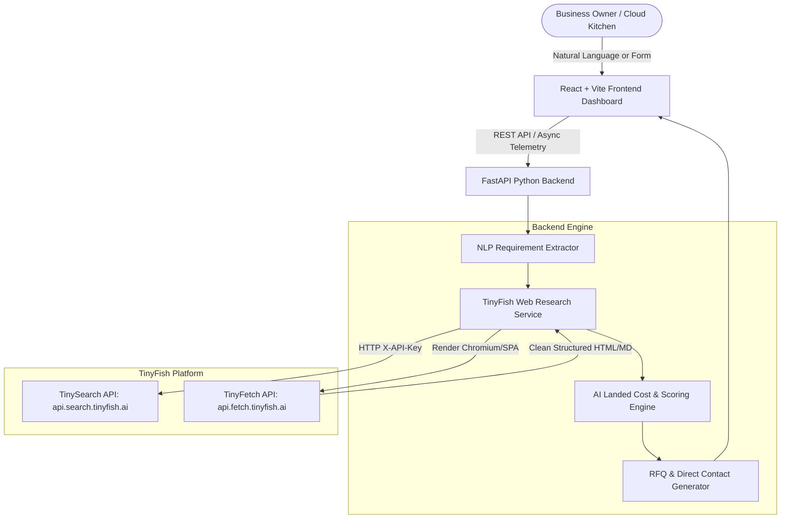

# ProcureSaathi - Complete Project Context & Architecture Guide
> **Audience**: AI Agents (LLMs), Software Engineers, Product Managers, Hackathon Evaluators.  
> **Purpose**: Single source of truth containing domain model, architecture, TinyFish web agent integration, cost calculation algorithms, data contracts, and contribution guide.

---

## 1. Executive Summary & Problem Statement

Small food businesses (cloud kitchens, independent restaurants, street food outlets, QSRs) and local retailers in India lose **15% to 30% of their operational budget** on procurement inefficiencies.

### The Pain Point:
When a cloud kitchen owner needs **5,000 food containers**, they must:
1. Spend hours manually browsing IndiaMART, Moglix, Industrybuying, Bizongo, and unindexed local suppliers.
2. Sift through misleading headline unit prices that omit **GST (12% or 18%)**, **freight/shipping charges**, and **hidden packaging surcharges**.
3. Fall into MOQ (Minimum Order Quantity) traps where low prices are only valid for 50,000+ units.
4. Risk delivery delays that jeopardize kitchen operations.

### The Solution: ProcureSaathi
**ProcureSaathi** is an autonomous AI-driven procurement copilot.
1. **Natural Language Requirement Input**: The owner enters a plain statement like *"I need 5,000 food containers, under ₹20,000, delivered within 7 days."*
2. **TinyFish Web-Research Engine**: Autonomous web agent navigates live supplier portals, searches live catalogs, renders JS-heavy product pages via Chromium stealth instances, and extracts real-time product prices, MOQs, delivery windows, and supplier verification credentials.
3. **AI Cost Normalization & Scoring**: Computes the **True Total Landed Cost** (Base price × quantity + GST + freight/shipping + handling), checks strict requirement compliance, and scores suppliers transparently.
4. **Ranked Recommendations & Direct Procurement Action**: Delivers a transparent ranking with clear rationale, evidence from supplier websites, and one-click direct RFQ generation (WhatsApp & Email).

---

## 2. System Architecture & Tech Stack



### Technology Selection:
- **Backend**: Python 3.14 + **FastAPI** (`backend/`)
  - Fast, asynchronous, type-safe with Pydantic v2 schemas.
  - Native integration with HTTP clients (`httpx`) for concurrent TinyFish requests.
  - Interactive OpenAPI Swagger documentation available at `http://localhost:8000/docs`.
- **Frontend**: **React** (Vite) + **Vanilla CSS Design System** (`frontend/`)
  - High-performance, reactive UI with rich animations and glassmorphism.
  - Live agent telemetry stepper showcasing TinyFish agent actions in real-time.
  - Interactive cost recalculation slider and comparison matrix.
- **Web Agent Engine**: **TinyFish** (`api.search.tinyfish.ai` & `api.fetch.tinyfish.ai`)
  - Live B2B search and JS-rendered scraping without brittle CSS selectors.
  - Resilient fallback engine with realistic Indian packaging supplier profiles for offline/hackathon evaluation.

---

## 3. TinyFish Web Agent Integration Deep-Dive

TinyFish is the core web-research engine of ProcureSaathi.

### 3.1 Authentication & Endpoints
- **Base Search Endpoint**: `GET https://api.search.tinyfish.ai/?query={query}&location=India`
- **Base Fetch Endpoint**: `POST https://api.fetch.tinyfish.ai/` with `{ "url": "{supplier_product_url}" }`
- **Authentication**: Header `X-API-Key: <TINYFISH_API_KEY>`

### 3.2 Two-Stage Extraction Pipeline
1. **Stage 1 (Discovery - TinySearch)**:
   - When a user requests *"5,000 food containers"*, the engine constructs targeted queries across Indian packaging domains:
     - `food packaging containers 750ml 500ml wholesale India site:indiamart.com OR site:moglix.com OR site:bizongo.com`
   - TinySearch returns clean JSON with URLs, titles, and snippets.
2. **Stage 2 (Deep Extraction - TinyFetch)**:
   - TinyFetch accesses the candidate URLs via Chromium instances.
   - Strips ads, navigation headers, cookie banners.
   - Extracts structured product specs:
     - Supplier Name, Location & Rating
     - Unit Price (₹) & MOQ (Minimum Order Quantity)
     - Tiered Pricing (e.g., 1k units @ ₹3.50, 5k units @ ₹2.90)
     - Delivery lead time (days)
     - GST tax status (inclusive or 18% extra)
     - Shipping / freight policy
     - Direct inquiry link / WhatsApp contact
3. **Resilience & Fallback**:
   - If `TINYFISH_API_KEY` is not provided or rate limits are reached, the system activates the **High-Fidelity Packaging Supplier Simulator**, ensuring zero broken demos during hackathon judging.

---

## 4. AI Cost Calculation & Ranking Methodology

The core differentiator of ProcureSaathi: **Never show misleading advertised base prices. Always show verified, comparable Total Landed Cost with transparent rationale.**

### 4.1 Total Landed Cost Formula
For an order quantity $Q$, requested delivery deadline $D_{req}$, and budget $B$:

$$\text{Subtotal} = Q \times \text{Unit Price}(Q)$$
$$\text{GST} = \text{Subtotal} \times \text{GST Rate (typically 12\% or 18\%) if not included}$$
$$\text{Shipping} = \begin{cases} 0 & \text{if Free Delivery threshold met} \\ \text{Base Freight} + (\text{Weight/Volume Factor}) & \text{otherwise} \end{cases}$$
$$\text{Handling/Platform Fee} = \text{Subtotal} \times 0.015 \text{ (1.5\%) capped at ₹300}$$
$$\mathbf{\text{Total Landed Cost}} = \text{Subtotal} + \text{GST} + \text{Shipping} + \text{Handling}$$

### 4.2 Scoring & Ranking Formula (0 to 100)
Each candidate supplier is scored against 5 weighted factors:
1. **Price Competitiveness (40%)**:
   - Compares supplier's Landed Cost against the average market price.
   - Bonus points if well under the user's budget ceiling $B$.
2. **Delivery Compliance (25%)**:
   - $100\%$ if Estimated Delivery Days $\le D_{req}$.
   - Steep penalty if estimated delivery exceeds user deadline.
3. **MOQ Feasibility (15%)**:
   - $100\%$ if $\text{MOQ} \le Q$.
   - Marked non-viable or penalized if user must over-purchase to meet supplier MOQ.
4. **Supplier Trust & Verification (15%)**:
   - GST-verified status, IndiaMART TrustSeal, ISO certification, customer review score ($\ge 4.5\bigstar$).
5. **Quality & Eco-Compliance (5%)**:
   - Food-grade certification (FSSAI approved), biodegradable/bagasse/recyclable material tags.

$$\text{Composite Score} = 0.40 S_{price} + 0.25 S_{delivery} + 0.15 S_{moq} + 0.15 S_{trust} + 0.05 S_{eco}$$

---

## 5. Directory Structure & File Map

```
ProcureSaathi/
├── .gitignore                  # Git ignore rules for node, python, env
├── .env.example                # Template for environment configuration
├── PROGRESS.md                 # Granular changelog tracking every milestone
├── PROJECT_CONTEXT.md          # THIS FILE: Master context for humans & LLMs
├── README.md                   # Hackathon pitch, quickstart, demo guide
│
├── backend/                    # Python FastAPI Backend
│   ├── main.py                 # FastAPI application entrypoint & routing
│   ├── config.py               # Environment & configuration management
│   ├── models/                 # Pydantic schemas (Request, Supplier, Analysis)
│   │   ├── __init__.py
│   │   ├── procurement.py      # User requirement schemas
│   │   └── supplier.py         # Supplier & Offer schemas
│   ├── services/
│   │   ├── __init__.py
│   │   ├── tinyfish_service.py # TinyFish Search & Fetch Web Agent client
│   │   ├── cost_engine.py      # Total landed cost & ranking algorithm
│   │   ├── mock_suppliers.py   # High-fidelity realistic supplier repository
│   │   └── rfq_service.py      # Direct WhatsApp/Email RFQ generator
│   ├── requirements.txt        # Backend dependencies
│   └── tests/                  # Backend unit & integration tests
│
└── frontend/                   # React + Vite Frontend Dashboard
    ├── index.html              # Clean HTML shell with Inter & Plus Jakarta Sans typography
    ├── package.json            # NPM dependencies & scripts
    ├── vite.config.js          # Vite configuration & backend proxy
    └── src/
        ├── main.jsx            # React root mount
        ├── App.jsx             # Main dashboard container, story movie launcher, state flow
        ├── App.css             # Layout utilities & visual accents
        ├── index.css           # Executive monochrome minimalist design system
        ├── components/
        │   ├── Header.jsx           # App bar, live mode toggle, movie toggle, settings launcher
        │   ├── RequirementForm.jsx  # Natural language prompt parser + structured presets form
        │   ├── AgentTelemetry.jsx   # Live TinyFish agent activity stepper & radar
        │   ├── ComparisonMatrix.jsx # 3D rotary dial showcase, ranked cards, resale profit simulator
        │   ├── Hero3DParcel.jsx     # Isometric 3D logistics consignment animation
        │   ├── StickFigureStoryMovie.jsx # 2D minimalist vector story movie & playback scrubber
        │   ├── NegotiationModal.jsx # Strategic B2B counter-offer proposal generator (WhatsApp RFQ)
        │   ├── CostBreakdownModal.jsx# True Landed Cost transparency drawer & evidence audit
        │   ├── HowItWorksModal.jsx  # 4-step procurement copilot workflow explainer
        │   ├── RFQModal.jsx         # 1-click WhatsApp/Email inquiry modal
        │   └── SettingsModal.jsx    # TinyFish API key configuration modal
        └── services/
            ├── api.js              # API client for backend communication with static host fallback
            └── clientSimulation.js # Offline & static host simulation engine for zero-downtime demos
```

---

## 6. How Future LLMs / Developers Can Extend This Project

When working on this repository, follow these conventions:

### Adding New Product Categories (e.g. Raw Spices, Dairy, Kitchen Utensils):
1. Navigate to `backend/services/mock_suppliers.py` and `tinyfish_service.py`.
2. Add category-specific keywords, typical GST rates (e.g. 5% for spices vs 18% for packaging), and standard bulk weight calculations.
3. Update `frontend/src/components/RequirementForm.jsx` presets list.

### Connecting Live WhatsApp Business API or Gmail:
1. In `backend/services/rfq_service.py`, replace formatted link generators (`wa.me/?text=...`) with Twilio / WhatsApp Cloud API or SendGrid / SMTP integrations.

### Adding New AI Models (Gemini / Claude / OpenAI):
1. The system is designed to allow pluggable LLM parsers in `backend/services/nlp_parser.py` to convert freeform natural language speech-to-text directly into structured `ProcurementRequest` models.

---

## 7. Development & Running Instructions

### Backend:
```bash
cd backend
python -m pip install -r requirements.txt
python -m uvicorn main:app --reload --port 8000
```
API docs available at: `http://localhost:8000/docs`

### Frontend:
```bash
cd frontend
npm install
npm run dev
```
Dashboard available at: `http://localhost:5173`
