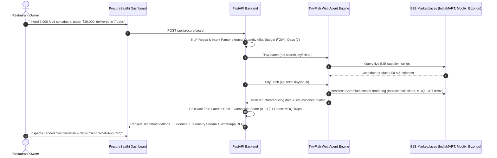

# 📦 ProcureSaathi (प्रोक्योर साथी)
### *Autonomous AI Procurement Copilot for Small Businesses & Cloud Kitchens*
> **Powered by TinyFish Web Operating Platform for AI Agents** 🐟🤖

[](https://fastapi.tiangolo.com)
[](https://react.dev)
[](https://vitejs.dev)
[](https://tinyfish.ai)
[](https://opensource.org/licenses/MIT)

---

## 🎯 1. What is ProcureSaathi?

Small food businesses (cloud kitchens, independent cafes, quick-service restaurants, kirana stores) in India lose **15% to 30% of their operational budget** on procurement inefficiencies. 

When a restaurant owner needs **5,000 food packaging containers**:
- They spend hours browsing unindexed catalogs on IndiaMART, Moglix, and regional B2B directories.
- They get trapped by **deceptive headline prices** (e.g. ₹2.40 advertised, but only if you buy 20,000 units).
- They get blindsided by **12% to 18% GST**, interstate freight, and handling surcharges at checkout.
- Delivery delays jeopardize kitchen operations and customer service.

**ProcureSaathi** is an autonomous web-agent platform that executes end-to-end procurement research in seconds. It understands freeform requirements, deploys **TinyFish** to crawl live B2B supplier portals, normalizes hidden taxes & shipping fees into **Verified True Landed Costs**, and generates **1-click WhatsApp/Email RFQ drafts**.

---

## 💡 2. The 4-Step Autonomous Workflow



---

## 🐟 3. Why TinyFish is Central to ProcureSaathi

Without TinyFish, procurement platforms rely on stale, manual databases that go out of date within weeks.
With TinyFish, ProcureSaathi has a live web operating engine:

1. **TinySearch (`api.search.tinyfish.ai`)**:
   - Live web search built for AI agents.
   - Discovers real supplier product URLs across domains without hardcoded scrapers.
2. **TinyFetch (`api.fetch.tinyfish.ai`)**:
   - Renders JavaScript-heavy single-page applications (SPAs) inside headless Chromium.
   - Strips cookie banners, headers, and ads to return structured content for LLM ingestion.
3. **Resilient Hybrid Fallback**:
   - Out of the box, if an API key is not yet configured or during offline hackathon presentations, ProcureSaathi seamlessly engages its curated B2B packaging repository so that demos never break.

---

## 💰 4. Key Differentiator: Advertised Price vs. True Landed Cost

| Factor | Advertised Headline Price (Deceptive) | ProcureSaathi True Landed Cost (Verified) |
| :--- | :--- | :--- |
| **Headline Unit Price** | ₹2.40 / unit | ₹2.85 / unit (verified for 5k volume tier) |
| **Minimum Order (MOQ)** | *Trapped! Requires 20,000 units* | **MOQ matched to your 5,000 order** |
| **GST Tax (18%)** | Excluded (Surprise invoice!) | ₹2,565.00 included transparently |
| **Logistics Freight** | Excluded | Free bulk logistics applied (order > ₹10k) |
| **Delivery Lead Time** | Unknown | 5 days (Verified within 7-day limit) |
| **Quality / Safety** | Unverified seller | FSSAI Food-Grade & Leakproof Verified |
| **Total Out-of-Pocket** | **₹26,185.00** (penalty sub-lot rate) | **₹16,957.50** (Net savings: ₹9,227.50) |

---

## 📁 5. Repository Structure

```
ProcureSaathi/
├── PROGRESS.md                 # Granular milestone & progress tracker
├── PROJECT_CONTEXT.md          # Master context document for humans & LLMs
├── README.md                   # This overview & presentation guide
├── run_dev.bat                 # 1-click Windows development launcher
├── run_dev.ps1                 # PowerShell development launcher
│
├── backend/                    # Python FastAPI Backend
│   ├── main.py                 # REST API routing & application entrypoint
│   ├── config.py               # Environment configuration
│   ├── models/                 # Pydantic data schemas
│   │   ├── procurement.py      # Requests, telemetry & responses
│   │   └── supplier.py         # Suppliers, tiered pricing & costs
│   ├── services/
│   │   ├── tinyfish_service.py # TinyFish Search & Fetch Web Agent client
│   │   ├── nlp_parser.py       # Natural language requirement parser
│   │   ├── cost_engine.py      # True Landed Cost & AI Scoring engine
│   │   ├── mock_suppliers.py   # High-fidelity B2B supplier database
│   │   └── rfq_service.py      # WhatsApp / Email 1-click RFQ generator
│   ├── requirements.txt        # Backend dependencies
│   └── tests/                  # Automated pytest suite
│
└── frontend/                   # React + Vite Frontend Dashboard
    ├── index.html              # HTML shell with Google Fonts
    ├── package.json            # NPM dependencies & scripts
    ├── vite.config.js          # Vite config & API reverse proxy
    └── src/
        ├── main.jsx            # React root mount
        ├── App.jsx             # Main interactive dashboard container
        ├── index.css           # Glassmorphic executive design system
        ├── components/
        │   ├── Header.jsx            # App bar & TinyFish agent status
        │   ├── RequirementForm.jsx   # Natural language & structured form
        │   ├── AgentTelemetry.jsx    # Live agent execution stream
        │   ├── ComparisonMatrix.jsx  # Ranked cards, metrics & slider
        │   ├── CostBreakdownModal.jsx# True Landed Cost waterfall modal
        │   ├── RFQModal.jsx          # WhatsApp / Email quote generator
        │   └── SettingsModal.jsx     # TinyFish API key configuration
        └── services/
            └── api.js          # REST client communicating with backend
```

---

## 🚀 6. Quickstart Guide

### Prerequisites
- **Node.js**: v18+ (tested on Node v24)
- **Python**: 3.10+ (tested on Python 3.14)
- **Git**

### Option A: 1-Click Launch (Windows)
Double-click `run_dev.bat` or run:
```powershell
.\run_dev.ps1
```

### Option B: Manual Setup

#### 1. Backend Setup:
```bash
cd backend
python -m pip install -r requirements.txt
python -m uvicorn main:app --reload --port 8000
```
- API Docs: [http://127.0.0.1:8000/docs](http://127.0.0.1:8000/docs)

#### 2. Frontend Setup:
```bash
cd frontend
npm install
npm run dev
```
- Web Application: [http://127.0.0.1:5173](http://127.0.0.1:5173)

---

## ☁️ 7. Deploying to Render (Zero Friction & Free Tier)

This repository includes a multi-stage `Dockerfile` and `render.yaml` blueprint to run the **FastAPI backend and React frontend together on a single free Render Web Service**.

### Option A: Automatic 1-Click Blueprint (Recommended)
1. Fork or push this repository to GitHub: `https://github.com/aarna605-dot/ScoutB2B`.
2. Log into [Render Dashboard](https://dashboard.render.com).
3. Click **New +** > **Blueprint**.
4. Connect the `ScoutB2B` repository.
5. Render reads `render.yaml` automatically:
   - Sets **Environment** to `Docker`
   - Sets Health Check to `/api/health`
   - Prompts for `TINYFISH_API_KEY` (optional; leave blank to use mock fallback)
6. Click **Apply**. Render builds the frontend, sets up FastAPI, and provides your live public HTTPS URL!

### Option B: Manual Web Service Setup
If not using Blueprints:
1. In Render Dashboard, click **New +** > **Web Service**.
2. Select your GitHub repository (`ScoutB2B`).
3. Choose **Docker** as the Runtime / Environment.
4. Set:
   - **Branch**: `main`
   - **Dockerfile Path**: `./Dockerfile`
   - **Instance Type**: `Free`
5. Under **Environment Variables**, add:
   - `ENABLE_MOCK_FALLBACK`: `true`
   - `TINYFISH_API_KEY`: *(your TinyFish key, optional)*
6. Click **Create Web Service**.

---


## 🧪 8. Running Tests

Run the backend test suite:
```bash
cd backend
python -m pytest tests/
```
```
collected 5 items
tests\test_procure.py .....                                 [100%]
============================== 5 passed in 1.30s ==============================
```

---

## 🤝 9. Future Roadmap & LLM Contribution Guide


If you or another AI assistant want to expand this repository:
1. **Read `PROJECT_CONTEXT.md` first**: Contains the full architectural specifications, data models, and cost formulas.
2. **Review `PROGRESS.md`**: Update milestone records whenever adding new features.
3. **Pluggable Extensions**:
   - Add new product categories in `backend/services/mock_suppliers.py`.
   - Connect live Twilio / WhatsApp Cloud API in `backend/services/rfq_service.py`.
   - Hook into Google GenAI / Gemini for voice-to-procurement input.

---

## 📄 License
MIT License. Built for the Hackathon with 💚 by the ProcureSaathi Team.
